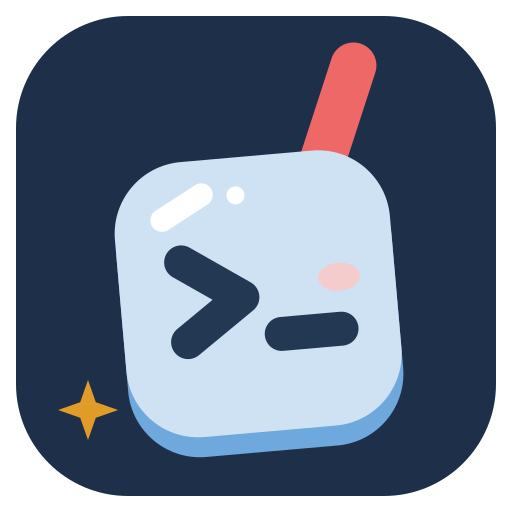
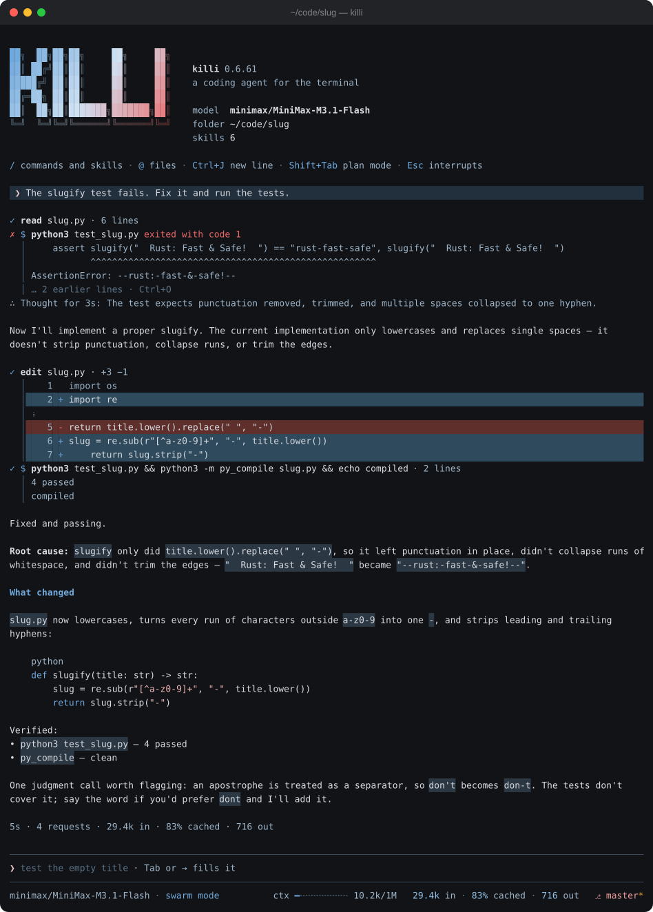
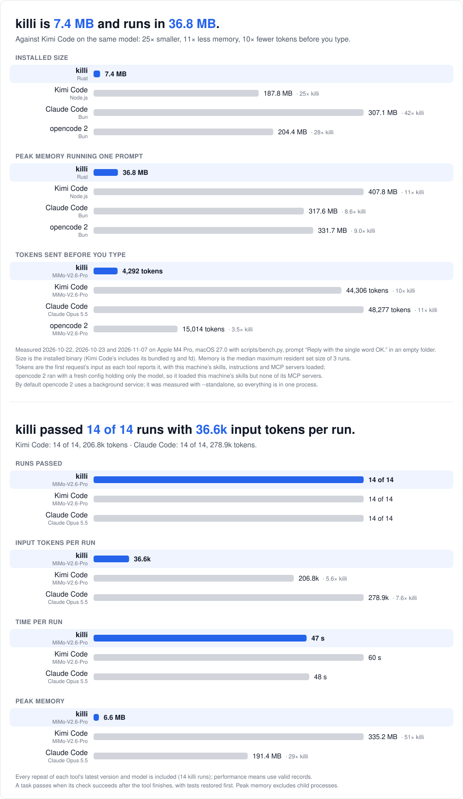
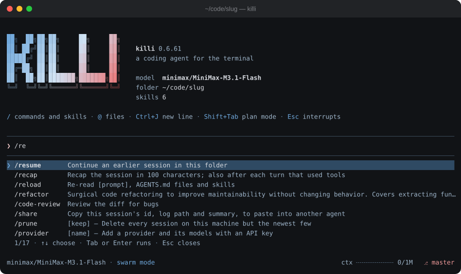
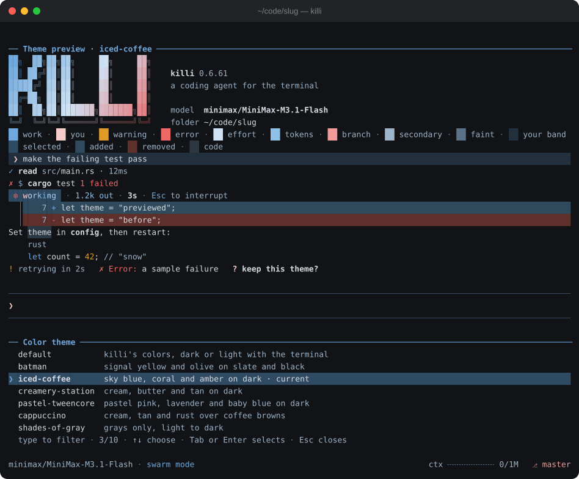

<p align="center">
  
</p>

<h1 align="center">killi</h1>

[](https://github.com/timwuhaotian/killi/actions/workflows/ci.yml)
[](https://github.com/timwuhaotian/killi/releases/latest)
[](LICENSE)


**killi is a fast, tiny, free and open-source AI coding agent for your terminal**, written in
Rust. It ships as one ~7 MB native binary for Apple silicon Macs — no runtime to install, starts
in under 10 ms, and uses about 18 MB of memory while running a prompt. Like Claude Code, Codex
CLI, opencode or Kimi Code, it reads your code, runs commands and edits files, but it works with
any OpenAI-compatible, Anthropic-compatible or OpenAI Responses LLM, including ChatGPT
subscriptions, and it supports MCP servers, subagents, plan mode, skills, hooks and `AGENTS.md`.
It is built around one idea: send the model as little as possible, and send it the same way
every time, so the provider's prompt cache keeps hitting (70–90% of input tokens come from the
cache). It is the sibling of the [Kil](https://github.com/timwuhaotian/kil) terminal and the
[Kiled](https://github.com/timwuhaotian/kiled) editor.

**killi at a glance**

| | killi |
|---|---|
| Installed size | ~7 MB single binary, no runtime |
| Startup | under 10 ms |
| Memory, one prompt | ~18 MB (Claude Code: 318 MB, Kimi Code: 408 MB, opencode 2: 332 MB) |
| System prompt + all tools | ~2,600 tokens |
| Input tokens, same evals | 5.6× fewer than Kimi Code |
| Prompt-cache hits | 70–90% |

<p align="center">
  
</p>

<p align="center">
  <picture>
    <source media="(prefers-color-scheme: dark)" srcset="docs/benchmarks-dark.svg">
    
  </picture>
</p>

How these were measured: [Size and memory](#size-and-memory) · [Capability tests](#capability-tests).

> **Status: early but actively developed.** Apple silicon Macs only. Used daily by its author; see [Known limitations](#known-limitations).

## Why killi

- **Long sessions stay cheap.** The prompt and tool list never change mid-session, and history
  is only appended to, so 70–90% of input tokens come from the provider's prompt cache.
- **The same work, far fewer tokens.** About 2,600 tokens for the whole prompt and every tool;
  every capability task Kimi Code passes, with 5.6× fewer input tokens.
- **Almost invisible on your machine.** One ~7 MB binary with no runtime to install, starting in
  under 10 ms and using about 18 MB of memory running a prompt.
- **No model lock-in.** Any OpenAI-compatible, Anthropic-compatible or OpenAI Responses LLM, on
  an API key or a ChatGPT subscription.
- **The full agent kit.** Subagents and swarms, plan mode, MCP servers, skills, hooks,
  `AGENTS.md` and undo — free and open source under MIT.

## Install

```sh
curl -fsSL https://raw.githubusercontent.com/timwuhaotian/killi/main/install.sh | sh
```

This puts `killi` in `~/.local/bin` after checking its SHA-256 against
[`releases/latest.toml`](releases/latest.toml). Later, `killi update` does the same in place.

## Build from source

```sh
cargo install --path crates/killi
```

Rust 1.94 or later.

## Features

- **Small and quick.** One 7 MB binary with no runtime to install. It starts in under 10 ms and
  uses about 18 MB of memory running a prompt, where Kimi Code uses 408 MB, Claude Code 318 MB
  and opencode 2 332 MB.
- **Few tokens.** The system prompt and every tool together come to about 2,600 tokens, plus
  your `AGENTS.md` files and about 4 tokens per installed skill. In the
  [capability tests](#capability-tests) killi passed every task Kimi Code passed, on the same
  model, with 5.6× fewer input tokens.
- **Cache-friendly by design.** The system prompt and the tool list are fixed for the whole
  session, and history is only appended to, never rewritten. Even plan mode, subagents and
  resumed sessions reuse the same cached prefix; 70–90% of input tokens come from the cache.
- **An interactive mode that stays out of the way.** The conversation prints into your
  terminal's own scrollback; only a small area at the bottom redraws: what's running, your task
  list, the prompt and a status line. Type `/` for a menu of commands and skills that narrows as
  you type. Type while the agent works and your message reaches it at its next step. Esc
  interrupts, and nothing it started keeps running.
- **Plan mode** (Shift+Tab): the agent researches and writes a plan; edits are blocked and
  bash runs only read-only commands until you approve it.
- **Tools that forgive small mistakes.** `edit` takes several changes in one call and still
  matches when only trailing spaces, smart quotes or dashes differ. Long output keeps its useful
  end and saves the rest to a file. Slightly broken tool-call JSON is repaired, not dropped.
- **Subagents** run in parallel on the same model and cached prompt. **Swarms** run one subagent
  per item of a prompt template, up to 128, several at a time, shown as one live panel (how many,
  which are working on what, how long each has run); swarm mode, on by default and set with
  `[agent] swarm` or `/swarm`, tells the agent to split its work that way. **Background tasks** keep servers and slow builds running. **Undo** puts
  your files back as they were before a turn, including what commands changed.
- **Sessions that know about each other.** Run several killi at once and each knows where the
  others work and what they are doing. The agent is told when another session works in its
  repository, to leave that session's changes alone, and how to ask it about its work or leave
  it a message. Nothing is added to the system prompt or the tool list.
- **Your setup, carried over.** Kimi Code's config layout (`killi import-kimi` copies it),
  skills from `~/.agents/skills`, MCP servers from `mcp.json`, Claude Code-style hooks, and
  `AGENTS.md` (or `CLAUDE.md`) files, including ones in subfolders.
- **Every session on disk**, exactly as sent, so `killi -c` continues where you left off with
  the cache still warm.
- **Updates itself.** `killi update` installs the latest release after checking its checksum,
  and a session that finds a newer release (at start and every six hours) prints what changed
  since your version and asks whether to install it now. `KILLI_NO_UPDATE_CHECK=1` turns the
  check off.

## FAQ

**What is killi?**
killi is a fast, tiny, open-source AI coding agent for the terminal, written in Rust. It ships as one ~7 MB native binary for Apple silicon Macs with no runtime to install, starts in under 10 ms, and uses about 18 MB of memory while running a prompt. Like Claude Code, Codex CLI, opencode or Kimi Code, it reads your code, runs commands and edits files, but it is free (MIT), works with any OpenAI-compatible, Anthropic-compatible or OpenAI Responses LLM, and is built so the provider's prompt cache keeps hitting.

**Is killi open source?**
Yes. killi is open source under the MIT license, and the full source is on GitHub at github.com/timwuhaotian/killi. It is free to use and installs as a single ~7 MB binary.

**How is killi different from Claude Code?**
Claude Code is Anthropic's closed-source agent tied to Anthropic models. killi is open source, model-agnostic, and much lighter: in the same benchmark, killi used about 18 MB of memory while Claude Code used 318 MB, Kimi Code 408 MB and opencode 2 332 MB. In killi's capability tests, killi passed every task Kimi Code passed on the same model with 5.6× fewer input tokens. Because killi never changes the system prompt or the tool list during a session, 70–90% of its input tokens are served from the provider's prompt cache.

**How much memory does killi use?**
About 18 MB of peak memory while running a prompt, measured on 2026-11-07 on an M4 Pro with [`scripts/bench.py`](scripts/bench.py) (hooks disabled). For comparison, the same benchmark measured Kimi Code at 408 MB, Claude Code at 318 MB and opencode 2 at 332 MB. The installed binary itself is about 7 MB.

**Does killi support ChatGPT?**
Yes. `killi login chatgpt` signs in with a ChatGPT Plus or Pro account in the browser, through OpenAI's sign-in for open-source tools. Requests go to api.openai.com/v1/responses on your plan, count toward your ChatGPT usage, and can be monitored in ChatGPT settings → Usage. killi also works with OpenAI-compatible APIs, Claude (Anthropic), and many other providers.

**Does killi support Claude / Anthropic models?**
Yes. killi accepts an Anthropic API key and speaks the Anthropic Messages protocol, so Claude models work directly. Claude models behind an OpenAI-compatible gateway can be used with the Responses protocol, with `cache_control` support for prompt caching.

**How many tokens does killi use?**
The system prompt and every tool together come to about 2,600 tokens, plus your `AGENTS.md` files and about 4 tokens per installed skill. In the capability tests, killi used 5.6× fewer input tokens than Kimi Code on the same model while passing the same tasks.

**What is prompt caching and why does killi care?**
Providers cache the start of a prompt, so a request that begins exactly like the previous one is cheaper and faster. killi is built around this: the system prompt, the tool list and the history are fixed for the whole session and only appended to, so 70–90% of input tokens come from the cache, including in plan mode, subagents, swarms and resumed sessions.

**How do I install killi?**
Run `curl -fsSL https://raw.githubusercontent.com/timwuhaotian/killi/main/install.sh | sh` to install the ~7 MB binary to `~/.local/bin` after a SHA-256 check, or build from source with `cargo install --path crates/killi` (Rust 1.94+). killi currently runs on Apple silicon Macs.

**Does killi support MCP servers, subagents and plan mode?**
Yes. killi supports MCP servers (stdio and HTTP) from `mcp.json`, subagents and swarms (up to 128 in parallel), plan mode that blocks edits until you approve, Claude Code-style hooks, `AGENTS.md` / `CLAUDE.md` instructions, skills, undo, background tasks and web search.

## killi vs Claude Code, Kimi Code and opencode

killi is an open-source, model-agnostic alternative to the big terminal coding agents, and it is much lighter. In the same benchmarks (measured with [`scripts/bench.py`](scripts/bench.py), see [Size and memory](#size-and-memory) and [Capability tests](#capability-tests)):

- **Memory:** about 18 MB while running a prompt, where Claude Code uses 318 MB, Kimi Code 408 MB and opencode 2 332 MB.
- **Tokens:** it passes every capability task Kimi Code passes on the same model, with 5.6× fewer input tokens.
- **Cost:** 70–90% of input tokens come from the provider's prompt cache, so long sessions stay cheap.
- **Vendor freedom:** works with any OpenAI-compatible, Anthropic-compatible or OpenAI Responses LLM — not tied to one model.
- **Open source:** MIT licensed, one ~7 MB native binary, no runtime.

## Size and memory

The top half of the chart above. Measured with [`scripts/bench.py`](scripts/bench.py); the versions and models are in
[`docs/bench.json`](docs/bench.json). killi, Kimi Code and opencode 2 ran the same model,
MiMo-V2.6-Pro; Claude Code ran its default, now Claude Opus 5.5 (Sonnet 5.5 in October, and its
token count moved with the model). killi, Kimi Code and Claude Code
loaded this machine's skills, global instructions and MCP servers; opencode 2 ran with a fresh
config holding only the model, so it loaded the skills but no MCP servers, and with `--standalone`
so that it is one process. killi (0.6.56) and Claude Code (2.1.319) were measured on 2026-11-07
on an M4 Pro; the Kimi Code (2.3.0) and opencode 2 (2.1.3) rows are from 2026-10-22 and 2026-10-23
on an M1 Pro. killi runs with `KILLI_NO_HOOKS=1`: hooks are your own programs in other
processes, so they don't count toward its memory.

## Capability tests

The bottom half of the chart above. Fourteen Rust and TypeScript tasks in [`evals/tasks`](evals/tasks): fixing bugs (one hidden in
a 1,400-line file), implementing features from a spec, clearing compiler and clippy errors,
a multi-file refactor, a concurrency bug, JSON escaping with no dependencies allowed, a fix
that must leave a shared file untouched, and a question answered from the code rather than a
misleading README. Each starts from a fresh git repo; it passes when its check (the tests,
clippy, or an exact answer) succeeds after the tool finishes, with the tests restored first.
Every task was checked to fail as given and pass with its reference solution.
[`scripts/eval.py`](scripts/eval.py) runs them; [docs/eval.md](docs/eval.md) has every result.
killi's row is 0.6.55, measured on 2026-11-07; Kimi Code's (2.2.0) and Claude Code's (2.1.306)
rows are from 2026-10-22. Each tool ran every task once, so a single task's token count can swing
by a third or more. killi's times were taken on a busy machine and aren't comparable with the
other two; tokens and memory are not affected by load.

## Using killi

### Models

killi reads `~/.killi/config.toml`. Run without a config, `killi` offers to make one
from another coding agent it finds on the machine — Kimi Code, pi, omp or opencode — carrying over
their providers, models, API keys, default model, thinking level and MCP servers into killi's
layout; providers those tools only reach through an account login are skipped. Otherwise it
writes a starting config to edit — and then keeps going. When the model it would start on has
no key — `$OPENAI_API_KEY` isn't set, say — it offers to paste the key (stored under
`[providers.*]` in the config, read with echo off) or to start on another configured model,
so a first run ends on a session instead of an error. On the first interactive launch a short
guide also offers to add another start command beside the binary (such as `dw` -> `killi`);
press Enter to keep starting it as `killi`. To write the config yourself: if you use Kimi
Code, copy its providers, models and MCP servers:

```sh
killi import-kimi
```

Otherwise `killi init` writes a starting config to edit. One with two providers looks like this:

```toml
default_model = "mimo/mimo-v2.6-pro"

# [thinking]
# enabled = false            # turns reasoning off everywhere; each model reasons at its
#                            # default_effort (what /effort last picked) otherwise

[providers.mimo]
type = "openai"              # OpenAI chat completions
base_url = "https://api.example.com/v1"
api_key_env = "MIMO_API_KEY" # or api_key = "..."

[providers.minimax]
type = "anthropic"           # Anthropic Messages
base_url = "https://api.example.com/anthropic"
api_key_env = "MINIMAX_API_KEY"

[models."mimo/mimo-v2.6-pro"]
provider = "mimo"
model = "mimo-v2.6-pro"
max_context_size = 1000000
max_output_size = 128000
capabilities = ["image_in", "thinking", "tool_use"]

[models."minimax/MiniMax-M3.1-Flash"]
provider = "minimax"
model = "MiniMax-M3.1-Flash"
```

To use a subscription instead of a pay-as-you-go key, run `killi login` and pick one, or name
it: `killi login chatgpt`, `killi login opencode-go`, `killi login muse-code` or `killi login
command-code`. Either way killi adds the provider and its models to the config; `killi logout`
signs out. Inside a session, `/provider` lists every preset and adds one from a pasted key:
opencode-go, muse-code and command-code, plus anthropic, kimi, mimo, minimax, qwen, stepfun,
unisound and zai. (ChatGPT and the browser sign-ins stay in `killi login`.) Run on a provider
the config already has, it also brings that provider's key, API and URL up to date (and the
tool names for muse-code) and keeps the rest.

- **ChatGPT** (Plus or Pro) signs in in the browser, through OpenAI's [sign-in for open-source
  tools](https://developers.openai.com/siwc/token-sharing-open-source), and keeps the credentials
  in `~/.killi/chatgpt.json`. Requests go to `api.openai.com/v1/responses` on your plan, and
  killi refreshes the hourly token itself; [ChatGPT settings → Usage](https://chatgpt.com/settings/usage)
  shows and limits what killi uses.
- **[OpenCode Go](https://opencode.ai/docs/go/)** takes the API key from the [OpenCode
  Console](https://opencode.ai/console) (`killi login` also takes `$OPENCODE_API_KEY`).
  Its models answer on Chat Completions, Responses or Anthropic Messages; killi writes
  each with the API and URL
  [models.dev](https://models.dev) gives it, and leaves out the ones on Gemini's API. Requests
  carry `x-opencode-session` with the session's ID, as OpenCode asks.
- **Muse Code** (Meta) takes the muse CLI's API key (`LLM|…`). killi writes a `meta` provider
  on the Responses API with `tool_names = { bash = "run_command", web_search = "search_web" }`:
  Meta refuses a subscription's requests whose tools carry another client's names, so the
  requests carry the mapped names and the replies are read back under killi's.
- **Command Code** signs in with your commandcode.ai account in the browser, the way its CLI
does, and writes a `commandcode` provider with the models the subscription serves
(`/provider command-code` takes a pasted key instead). Requests speak the CLI's own API
(`/alpha/generate`) and count toward the subscription's usage.

A model can use OpenAI's Responses API with `protocol = "openai_responses"`. A Claude model
behind an OpenAI-compatible gateway (Bedrock through LiteLLM) caches nothing unless the request
marks it: set `cache_control = true` on that model, and check with `scripts/probe.py cache`.

### Working with it

```sh
killi                        # start a session here
killi -c                     # continue the last session in this folder
killi -r                     # pick an earlier session
killi -p "fix the failing test in src/lib.rs"   # run one task and exit
killi -p "..." --json        # one JSON summary: tokens, cache hits, time
```

| Key | |
|---|---|
| / | the command menu: ↑↓ choose, Tab completes, Enter runs, Esc closes |
| @ | the file menu: fuzzy-search the workspace, Tab or Enter inserts `@path`; the file's contents go to the model with your message |
| Enter | send; while the agent works, your message reaches it at its next step |
| Shift+Enter, Ctrl+J | new line |
| ! | run a shell command without involving the model; a bare `!` opens your shell |
| Esc | interrupt; before the reply begins, your message comes back to the prompt as if never sent |
| Ctrl+S | while the agent works, interrupt it and send your message now; during a swarm the first press only queues it |
| Ctrl+C | copy the prompt's selection, else clear the prompt; on an empty prompt, interrupt, twice to quit |
| Shift+Tab | plan mode |
| Ctrl+V | paste an image from the clipboard as `[Image #1]` (Cmd+V too in [Kil](https://github.com/timwuhaotian/kil)) |
| drag a file in | an image is attached as `[Image #1]`; any other file is named as `@path` |
| Ctrl+O | the last tool output or thought in full |
| ↑ ↓ | history |
| Tab, → | at the end of the prompt, take the faint suggestion after it |
| Shift+arrows, Shift+Home/End | select in the prompt, by words with Alt; typing replaces the selection, Ctrl+C copies it; in fullscreen mode a drag, double- or triple-click selects too |

<p align="center">
  
</p>

Commands: `/provider [name]` (add a provider from a pasted key), `/model [alias]`, `/theme [name]` (color theme),
`/backup-model [alias]` (the fallback when the primary keeps failing), `/mcp [server]`
(turn servers on or off), `/web-search-config`, `/effort [level]` (thinking effort),
`/new` (or `/clear`), `/resume`, `/btw <question>` (a side question, never kept),
`/compact [focus]`, `/recap`, `/undo`, `/plan`, `/swarm [task|on|off]`,
`/goal [<text>|done|clear]` (a session goal: `/exit`, `/new` and `/resume` wait until it is
`/goal done`, or `/goal clear` when it is truly impossible or no longer wanted), `/usage`, `/session`
(copies the session's id, log path and summary for another agent to read), `/sessions` (the
other killi sessions running on this machine), `/later [done N]` (what the agent noted for
later in this folder), `/prune [keep]`
(deletes every session on the machine but the newest few), `/reload`,
`/help`, `/exit`, and
`/<skill-name> [request]` for any skill. The menu matches loosely, the way Kimi Code's does:
`/cr` finds `code-review`.

Ten color themes: `/theme` previews each one live — its banner gradient, diff stripes and
status colors — as the selection moves, before you pick. The screenshots here wear
`iced-coffee` (sky blue, coral and amber on dark), the palette the icon is drawn from.

<p align="center">
  
</p>

After a turn that used tools, killi prints a recap of the session in 100 characters or fewer
under the turn's totals; `/recap` asks for one at any time, and `[ui] recap = false` turns the
automatic one off. A recap is a side request like `/btw`: it is never kept in the conversation
and the cached prefix still hits.

After a turn ends, the model suggests what to ask next: the empty prompt shows the suggestion
as its placeholder, and Tab or → puts it in the prompt. Once you take it, or pause for a second
while typing a prompt, the model guesses how the prompt goes on and shows that faint after the
cursor; Tab or → takes it and asks for more, and typing along it keeps it. Each is a side request
like `/btw`, so it is never kept in the conversation and the cached prefix still hits.

killi runs commands and edits files without asking; `/undo` is the safety net.

**Things for later.** When the agent notices a blocker, a bug in passing or an improvement
it won't do now, it notes it with its `later` tool right then, instead of holding it for the
final message, one list per folder in `~/.killi/sessions/<folder>/later.md` with open items
only. `/later` shows the list, `/later done 3` crosses one off, and the banner says how many
are open.

**Other sessions.** Every killi running on the machine is listed in `~/.killi/live`. When one starts or stops there, the
agent is told once: changes it didn't make may be theirs, and branch switches, stashes and
resets belong in a worktree. `/undo` says when it would also undo another session's work. From
the agent's shell, or yours:

```sh
killi sessions                 # every session: pid, working or idle, folder, branch, prompt
killi sessions 4321            # what one is doing now: its task list, what it waits on
killi ask 4321 "which files are you changing?"   # its model answers from its conversation; nothing is kept
killi tell 4321 "the base branch is pushed"      # a message for its next step, or its next prompt when idle
```

A message is marked as not coming from the user, never starts a turn, and a session takes at
most three between two prompts. `[agent] peers = false` keeps a session to itself.

### System prompt, instructions, skills, MCP and hooks

- **System prompt:** its guidance (how the agent works, and the safety rules) sits in
  `config.toml` under `[prompt] system`, to read and edit; `/reload` applies a change.
  `killi init` writes it there, or adds it to a config that has none. While it's there, killi
  updates don't change your prompt; delete the table to go back to the built-in text.
- **Instructions:** `~/.agents/AGENTS.md`, then every `AGENTS.md` from the git root down to
  the working directory (or `CLAUDE.md` where there is no `AGENTS.md`; `@file` lines are
  followed). When the agent works in a subfolder with its own `AGENTS.md`, it is pointed to it.
- **Skills:** folders with a `SKILL.md` in `~/.agents/skills` and the project's
  `.agents/skills` or `.claude/skills`. Only their names go in the prompt; the agent loads one
  when it applies, and `/<name>` runs one directly. A skill's declared sub-commands (its
  Commands table or `command-metadata.json`, like impeccable's `polish`) are names too:
  `/polish` loads the parent skill with that playbook appended. Other folders:
  `[skills] dirs = [...]`.
  One is built in: `/update-config` tells the agent every file and key of this version's
  configuration, so it can say where things are, what a setting does, or make a change.
  Project installs from `npx skills add` (any agent that uses `.agents/skills`) land there, and
  so do global installs with `-g -a pi` (or `codex`, `cline`), so killi sees them. Installers
  look for killi by the `~/.killi` folder, which `install.sh` creates.
- **MCP:** servers from `~/.killi/mcp.json` and the project's `.mcp.json`, in the usual
  `{"mcpServers": {...}}` format (stdio or HTTP). The agent reaches them through one `mcp` tool,
  and a server starts, and its tools load, the first time it's used. To give a project's
  favorite server native tools from the start, add `[mcp] eager = ["godot"]` to its
  `.killi/config.toml`. Stdio servers run in one shared `killi mcp-serve` process, so every
  killi session on the machine uses the same server instead of starting its own; it exits 15
  minutes after the last session lets go. User servers start in your home folder, project
  servers in the project root. `/mcp` lists the servers and turns one on or off, for this
  session and the next ones. The project `.mcp.json` is the file `add-mcp` writes for Claude
  Code, so servers added there reach killi too.
- **Hooks** use Claude Code's protocol (JSON on stdin; exit code 2 blocks and tells the model
  why):

  ```toml
  [[hooks.PreToolUse]]
  matcher = "bash"             # a regex over tool names
  command = "~/bin/no-force-push.sh"
  ```

  Events: `SessionStart`, `UserPromptSubmit`, `PreToolUse`, `PostToolUse`, `Stop`,
  `SubagentStop`, `SessionEnd` (when the session exits, only if a turn ran). A `PostToolUse` hook that prints something (or exits 2) shows its output to
  the model, which makes a cheap stand-in for an editor's diagnostics: run the type checker
  after every edit.

  ```toml
  [[hooks.PostToolUse]]
  matcher = "edit|write"
  command = "cargo check --quiet 2>&1 | head -30; exit 0"
  ```

  `KILLI_NO_HOOKS=1` runs a session with every hook off.

- **Entire:** killi sessions checkpoint to [Entire](https://entire.io), which mirrors the
  repo and links each commit to the session behind it (see the
  [quickstart](https://docs.entire.com/quickstart)). `entire agent add` has no killi entry,
  but killi speaks Claude Code's hook protocol, so the wiring in `/update-config` (seven
  hooks in `~/.killi/config.toml`) checkpoints every session on start, prompt, tool use,
  stop and exit.

- **Web:** `web_search` finds pages and `fetch_url` reads them. Without setup, search reads
  Brave's public results page, which can turn automated requests away. `/web-search-config`
  asks for the service and what it needs, writes `[search]` and applies it at once; by hand
  (`provider` is `"brave"`, `"tavily"` or `"searxng"`):

  ```toml
  [search]
  provider = "brave"
  api_key_env = "BRAVE_API_KEY"   # or: api_key = "..."
  ```

  `"searxng"` points at your own instance instead of a key — self-hosted, with the json format
  enabled (`settings.yml`: `search → formats: [html, json]`) — and takes an optional key:

  ```toml
  [search]
  provider = "searxng"
  url = "http://localhost:8888"
  ```

  `fetch_url` also renders pages that need JavaScript, takes screenshots of them (`screenshot`,
  for checking a local dev server's UI) and fetches raw bodies (`raw`), all through Moli when
  it is installed (`KILLI_MOLI`, `~/.local/bin/moli`, or `moli` on `PATH`), else the Chrome,
  Chromium, Edge or Brave in `/Applications` (or `KILLI_CHROME`) run headless with a throwaway
  profile. A page whose static HTML has no readable text is rendered automatically.

## How it works

Providers cache the start of a prompt, so a request that begins exactly like the last one is
cheaper and faster ([OpenAI](https://platform.openai.com/docs/guides/prompt-caching),
[Anthropic](https://docs.anthropic.com/en/docs/build-with-claude/prompt-caching)). killi keeps
that start identical:

- The system prompt, your `AGENTS.md` files and the tool definitions are built once when the
  session starts and never change. Plan mode blocks writes when a tool runs instead of removing
  tools; MCP servers are reached through one fixed tool; subagents get the same prompt and tools.
- Messages are stored exactly as sent, tool-call arguments and reasoning included, and nothing
  earlier is ever edited or merged. Notes from killi to the model go at the end. Only
  compaction rewrites history, and it keeps your requests word for word.
> On MiMo, changing the tool list mid-session dropped a request's cached tokens to zero,
> history included. That measurement shaped the rest.

The design, with the measurements behind each choice, is in
[docs/decisions.md](docs/decisions.md).

## Known limitations

- **Apple silicon Macs only.** killi currently ships for macOS on Apple silicon; Intel Macs, Linux and Windows are not supported yet.
- **Early software.** Used daily by its author, but expect rough edges; `/undo` and git are your safety nets.
- **Small benchmark set.** The capability tests cover 14 tasks, and measurements were taken on a small number of machines and models — see [Size and memory](#size-and-memory) and [Capability tests](#capability-tests).

## Development

```sh
cargo clippy --workspace --all-targets -- -D warnings
cargo test --workspace
python3 scripts/eval.py verify   # every capability task fails as given and passes when solved
```

Releases are described in [RELEASING.md](RELEASING.md).

## License

[MIT](LICENSE)
