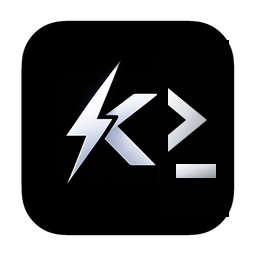
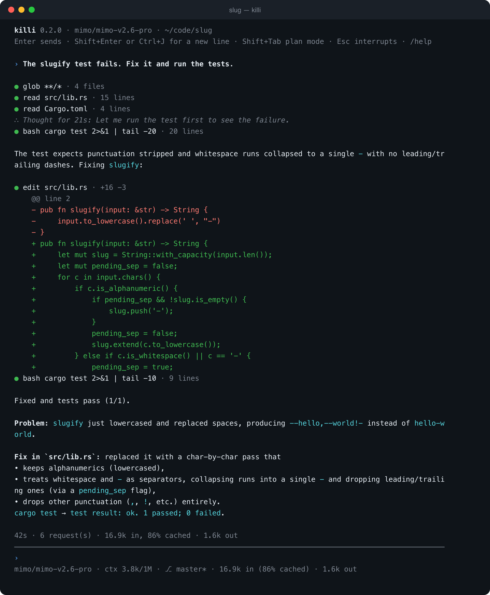
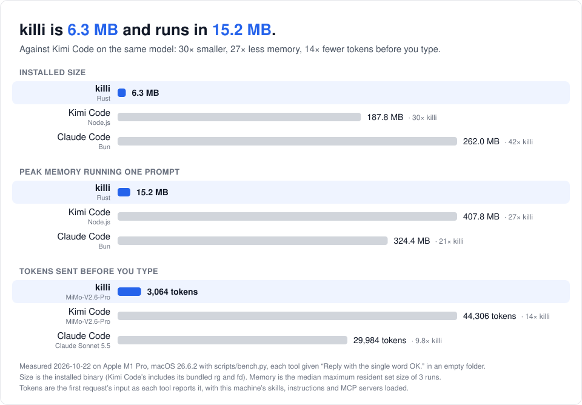
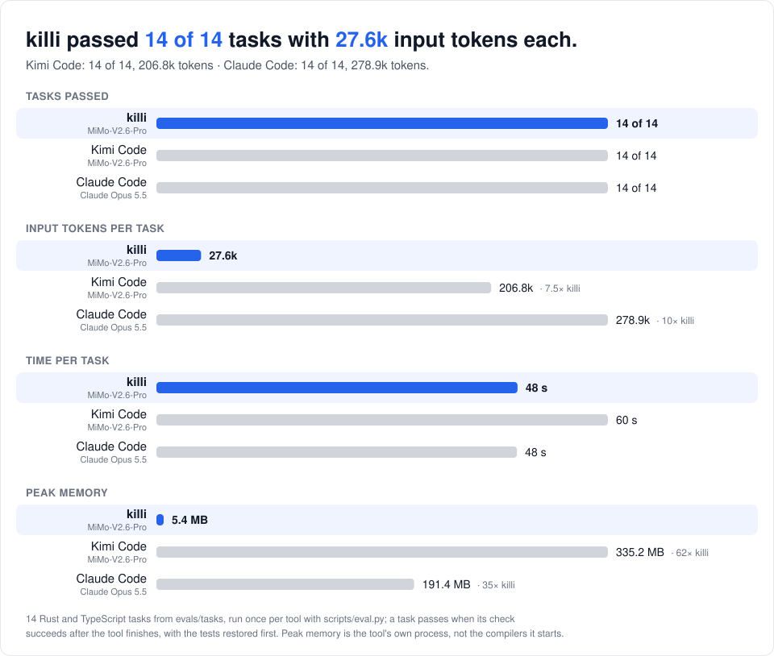
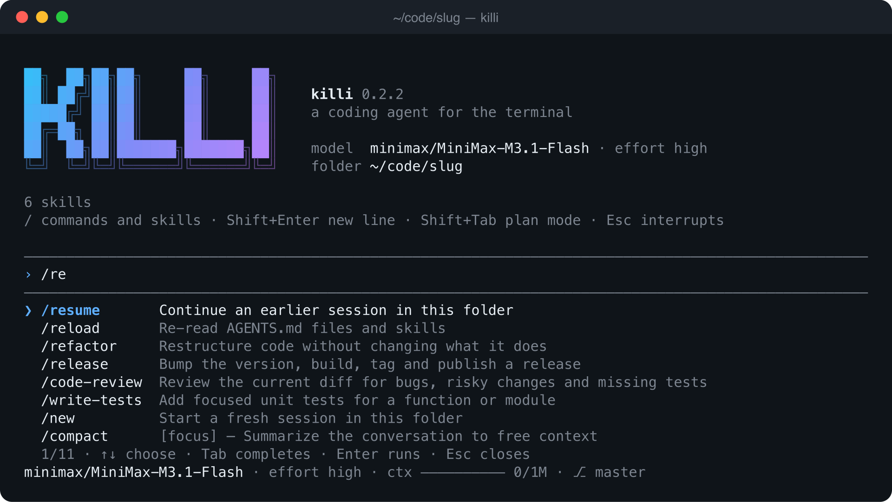

<p align="center">
  
</p>

<h1 align="center">killi</h1>

[](https://github.com/timwuhaotian/killi/actions/workflows/ci.yml)
[](LICENSE)


A coding agent for the terminal, written in Rust (6 MB). It reads your code, runs commands and
edits files with OpenAI-compatible, Anthropic-compatible or OpenAI Responses models, and it is
built around one idea: send the model as little as possible, and send it the same way every
time, so the provider's prompt cache keeps hitting. It is the sibling of the
[Kil](https://github.com/timwuhaotian/kil) terminal and the
[Kiled](https://github.com/timwuhaotian/kiled) editor.

<p align="center">
  
</p>

> **Status: early.** Apple silicon Macs only. Used daily by its author; expect rough edges.

## Features

- **Small and quick.** One 6 MB binary with no runtime to install. It starts in under 20 ms and
  uses about 15 MB of memory running a prompt, where Kimi Code uses 408 MB and Claude Code 324 MB.
- **Few tokens.** The system prompt and every tool together come to about 2,600 tokens, plus
  your `AGENTS.md` files and about 4 tokens per installed skill. In the
  [capability tests](#capability-tests) killi passed every task Kimi Code passed, on the same
  model, with 5.6× fewer input tokens.
- **Cache-friendly by design.** The system prompt and the tool list are fixed for the whole
  session, and history is only appended to, never rewritten. Even plan mode, subagents and
  resumed sessions reuse the same cached prefix; 70–90% of input tokens come from the cache.
- **An interactive mode that stays out of the way.** The conversation prints into your
  terminal's own scrollback; only a small area at the bottom redraws: what's running, your task
  list, the prompt and a status line. Type `/` for a menu of commands and skills that narrows as
  you type. Type while the agent works and your message reaches it at its next step. Esc
  interrupts, and nothing it started keeps running.
- **Plan mode** (Shift+Tab): the agent researches and writes a plan; edits are blocked and
  bash runs only read-only commands until you approve it.
- **Tools that forgive small mistakes.** `edit` takes several changes in one call and still
  matches when only trailing spaces, smart quotes or dashes differ. Long output keeps its useful
  end and saves the rest to a file. Slightly broken tool-call JSON is repaired, not dropped.
- **Subagents** run in parallel on the same model and cached prompt. **Swarms** run one subagent
  per item of a prompt template, up to 128, several at a time; `/swarm` tells the agent to split
  its work that way. **Background tasks** keep servers and slow builds running. **Undo** puts
  your files back as they were before a turn, including what commands changed.
- **Your setup, carried over.** Kimi Code's config layout (`killi import-kimi` copies it),
  skills from `~/.agents/skills`, MCP servers from `mcp.json`, Claude Code-style hooks, and
  `AGENTS.md` (or `CLAUDE.md`) files, including ones in subfolders.
- **Every session on disk**, exactly as sent, so `killi -c` continues where you left off with
  the cache still warm.
- **Updates itself.** `killi update` installs the latest release after checking its checksum.

## Size and memory

<picture>
  <source media="(prefers-color-scheme: dark)" srcset="docs/bench-dark.svg">
  
</picture>

Measured with [`scripts/bench.py`](scripts/bench.py); the versions and models are in
[`docs/bench.json`](docs/bench.json). killi and Kimi Code ran the same model, MiMo-V2.6-Pro;
Claude Code ran its default, Claude Sonnet 5.5. All three loaded this machine's skills, global
instructions and MCP servers.

## Capability tests

<picture>
  <source media="(prefers-color-scheme: dark)" srcset="docs/eval-dark.svg">
  
</picture>

Fourteen Rust and TypeScript tasks in [`evals/tasks`](evals/tasks): fixing bugs (one hidden in
a 1,400-line file), implementing features from a spec, clearing compiler and clippy errors,
a multi-file refactor, a concurrency bug, JSON escaping with no dependencies allowed, a fix
that must leave a shared file untouched, and a question answered from the code rather than a
misleading README. Each starts from a fresh git repo; it passes when its check (the tests,
clippy, or an exact answer) succeeds after the tool finishes, with the tests restored first.
Every task was checked to fail as given and pass with its reference solution.
[`scripts/eval.py`](scripts/eval.py) runs them; [docs/eval.md](docs/eval.md) has every result.
killi's row is 0.2.16; Kimi Code's and Claude Code's were measured earlier (2.2.0 and 2.1.306), and each
tool ran every task once, so a single task's token count can swing by a third or more. killi's times
were taken on a busy machine and aren't comparable with the other two; tokens and memory are not
affected by load.

## Install

```sh
curl -fsSL https://github.com/timwuhaotian/killi/raw/main/install.sh | sh
```

This puts `killi` in `~/.local/bin` after checking its SHA-256 against
[`releases/latest.toml`](releases/latest.toml). Later, `killi update` does the same in place.

## Build from source

```sh
cargo install --path crates/killi
```

Rust 1.94 or later.

## Using killi

### Models

killi reads `~/.killi/config.toml`. Run without one, `killi` offers to make it: by importing
Kimi Code's, or from a starting config to edit. To do that yourself: if you use Kimi Code, copy
its providers, models and MCP servers:

```sh
killi import-kimi
```

Otherwise `killi init` writes a starting config to edit. It looks like this:

```toml
default_model = "mimo/mimo-v2.6-pro"

[thinking]
effort = "high"              # or enabled = false

[providers.mimo]
type = "openai"              # OpenAI chat completions
base_url = "https://api.example.com/v1"
api_key_env = "MIMO_API_KEY" # or api_key = "..."

[providers.minimax]
type = "anthropic"           # Anthropic Messages
base_url = "https://api.example.com/anthropic"
api_key_env = "MINIMAX_API_KEY"

[models."mimo/mimo-v2.6-pro"]
provider = "mimo"
model = "mimo-v2.6-pro"
max_context_size = 1000000
max_output_size = 128000
capabilities = ["image_in", "thinking", "tool_use"]

[models."minimax/MiniMax-M3.1-Flash"]
provider = "minimax"
model = "MiniMax-M3.1-Flash"
```

A model can use OpenAI's Responses API with `protocol = "openai_responses"`.

### Working with it

```sh
killi                        # start a session here
killi -c                     # continue the last session in this folder
killi -r                     # pick an earlier session
killi -p "fix the failing test in src/lib.rs"   # run one task and exit
killi -p "..." --json        # one JSON summary: tokens, cache hits, time
```

| Key | |
|---|---|
| / | the command menu: ↑↓ choose, Tab completes, Enter runs, Esc closes |
| Enter | send; while the agent works, your message reaches it at its next step |
| Shift+Enter, Ctrl+J | new line |
| Esc | interrupt |
| Shift+Tab | plan mode |
| Ctrl+O | the last tool output or thought in full |
| ↑ ↓ | history |

<p align="center">
  
</p>

Commands: `/model [alias]`, `/effort [level]` (thinking effort), `/new` (or `/clear`),
`/resume`, `/compact [focus]`, `/undo`, `/plan`, `/swarm [task|on|off]`, `/usage`, `/reload`,
`/help`, `/exit`, and
`/<skill-name> [request]` for any skill. The menu matches loosely, the way Kimi Code's does:
`/cr` finds `code-review`.

killi runs commands and edits files without asking; `/undo` is the safety net.

### System prompt, instructions, skills, MCP and hooks

- **System prompt:** its guidance (how the agent works, and the safety rules) sits in
  `config.toml` under `[prompt] system`, to read and edit; `/reload` applies a change.
  `killi init` writes it there, or adds it to a config that has none. While it's there, killi
  updates don't change your prompt; delete the table to go back to the built-in text.
- **Instructions:** `~/.agents/AGENTS.md`, then every `AGENTS.md` from the git root down to
  the working directory (or `CLAUDE.md` where there is no `AGENTS.md`; `@file` lines are
  followed). When the agent works in a subfolder with its own `AGENTS.md`, it is pointed to it.
- **Skills:** folders with a `SKILL.md` in `~/.agents/skills` and the project's
  `.agents/skills` or `.claude/skills`. Only their names go in the prompt; the agent loads one
  when it applies, and `/<name>` runs one directly. Other folders: `[skills] dirs = [...]`.
- **MCP:** servers from `~/.killi/mcp.json` and the project's `.mcp.json`, in the usual
  `{"mcpServers": {...}}` format (stdio or HTTP). The agent reaches them through one `mcp` tool,
  and a server starts, and its tools load, the first time it's used. To give a project's
  favorite server native tools from the start, add `[mcp] eager = ["godot"]` to its
  `.killi/config.toml`. Stdio servers run in one shared `killi mcp-serve` process, so every
  killi session on the machine uses the same server instead of starting its own; it exits 15
  minutes after the last session lets go. User servers start in your home folder, project
  servers in the project root. `/mcp` lists the servers and turns one on or off, for this
  session and the next ones.
- **Hooks** use Claude Code's protocol (JSON on stdin; exit code 2 blocks and tells the model
  why):

  ```toml
  [[hooks.PreToolUse]]
  matcher = "bash"             # a regex over tool names
  command = "~/bin/no-force-push.sh"
  ```

  Events: `SessionStart`, `UserPromptSubmit`, `PreToolUse`, `PostToolUse`, `Stop`,
  `SubagentStop`. A `PostToolUse` hook that prints something (or exits 2) shows its output to
  the model, which makes a cheap stand-in for an editor's diagnostics: run the type checker
  after every edit.

  ```toml
  [[hooks.PostToolUse]]
  matcher = "edit|write"
  command = "cargo check --quiet 2>&1 | head -30; exit 0"
  ```

- **Web:** `web_search` finds pages and `fetch_url` reads them. Without setup, search reads
  Brave's public results page, which can turn automated requests away; for reliable results
  add a key (`provider` is `"brave"` or `"tavily"`):

  ```toml
  [search]
  provider = "brave"
  api_key_env = "BRAVE_API_KEY"   # or: api_key = "..."
  ```

  `fetch_url` also renders pages that need JavaScript, takes screenshots of them (`screenshot`,
  for checking a local dev server's UI) and fetches raw bodies (`raw`), all through the Chrome,
  Chromium, Edge or Brave in `/Applications` (or `KILLI_CHROME`) run headless with a throwaway
  profile. A page whose static HTML has no readable text is rendered automatically.

## How it works

Providers cache the start of a prompt, so a request that begins exactly like the last one is
cheaper and faster. killi keeps that start identical:

- The system prompt, your `AGENTS.md` files and the tool definitions are built once when the
  session starts and never change. Plan mode blocks writes when a tool runs instead of removing
  tools; MCP servers are reached through one fixed tool; subagents get the same prompt and tools.
- Messages are stored exactly as sent, tool-call arguments and reasoning included, and nothing
  earlier is ever edited or merged. Notes from killi to the model go at the end. Only
  compaction rewrites history, and it keeps your requests word for word.
- On MiMo, changing the tool list mid-session dropped a request's cached tokens to zero,
  history included. That measurement shaped the rest.

The design, with the measurements behind each choice, is in
[docs/decisions.md](docs/decisions.md).

## Development

```sh
cargo clippy --workspace --all-targets -- -D warnings
cargo test --workspace
python3 scripts/eval.py verify   # every capability task fails as given and passes when solved
```

Releases are described in [RELEASING.md](RELEASING.md).

## License

[MIT](LICENSE)
